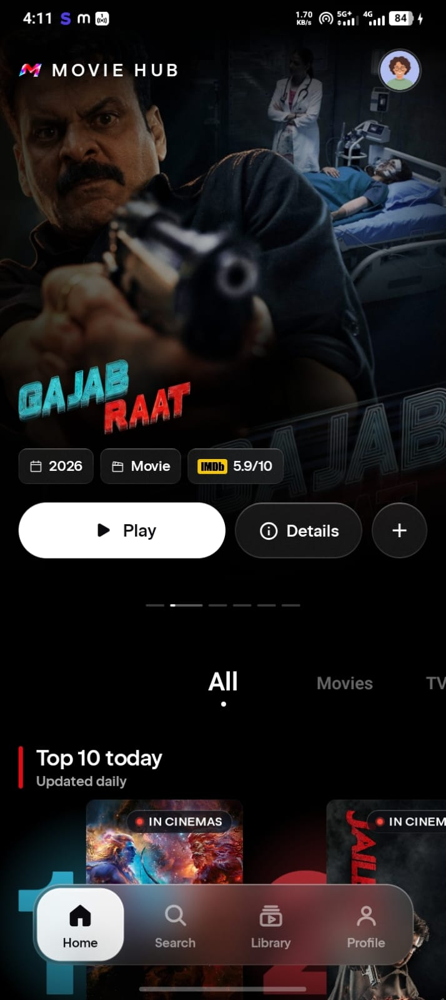
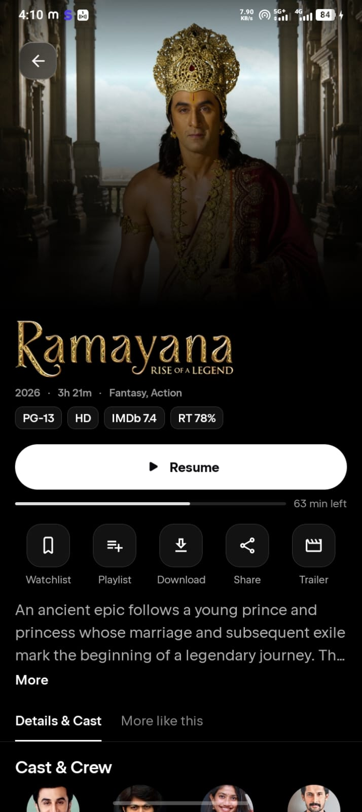
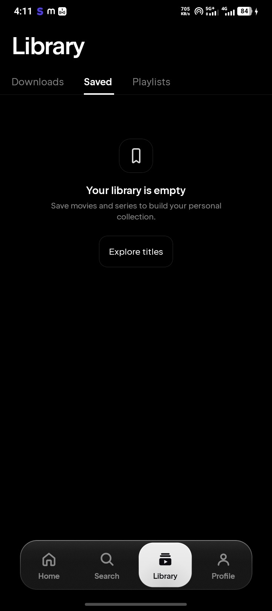
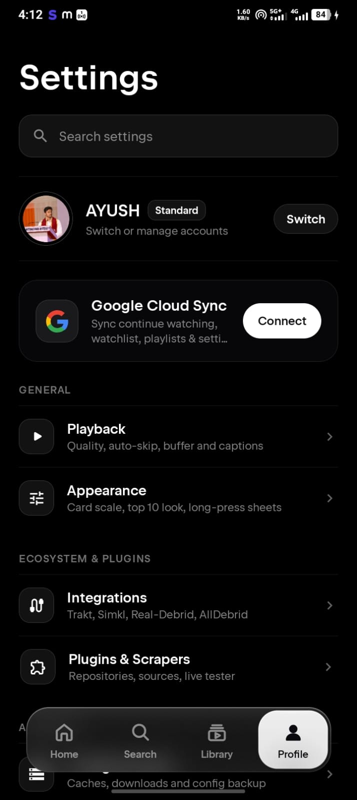
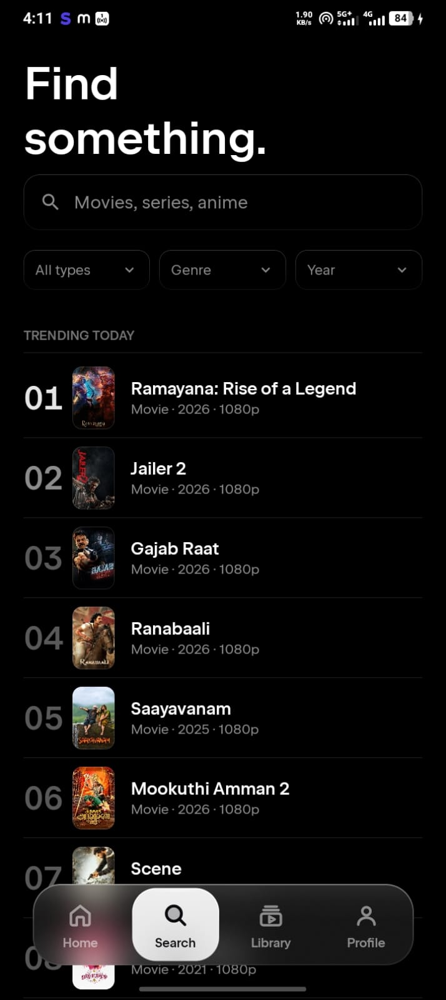

# MOVIE HUB
### YOUR ENTERTAINMENT. ONE CINEMATIC HUB.

**A Next-Generation Open-Source Entertainment & Streaming Client for Android**

*Discover. Stream. Personalize.*

[⬇️ DOWNLOAD LATEST APK](https://github.com/divyanshupandey0/movie-hub/releases/latest) · [💬 TELEGRAM COMMUNITY](https://t.me/movie_hub_officialll) · [📦 REPOSITORY](https://github.com/divyanshupandey0/movie-hub)

---

## ✦ ABOUT MOVIE HUB

**MOVIE HUB** is a high-performance Android entertainment application designed to deliver an elevated, cinematic media discovery and playback experience. Built with modern Android architecture using **Kotlin** and **Jetpack Compose**, MOVIE HUB unifies movie catalogs, TV series tracking, smart search filtering, modular scraper integrations, and intelligent audio selection into one seamless interface.

### Highlights
- 🎨 **Cinematic UI/UX:** Sleek dark-mode aesthetic with custom gold accents, fluid transitions, and ergonomic navigation.
- 🔊 **Intelligent Hindi Audio Auto-Selection:** Automatically detects and switches to Hindi audio tracks for movies and series whenever available, falling back gracefully to original audio.
- ⚡ **Enhanced Media Playback:** Powered by an optimized ExoPlayer engine with instant seek, forward-skip stability, and resume progress tracking.
- 🔍 **Smart Discovery:** Deep filtering by categories, genres, release years, and daily trending leaderboards.
- 🔌 **Extensible Plugin Ecosystem:** Modular architecture supporting custom third-party scrapers, repositories, and real-time tester tools.
- ☁️ **Cloud Synchronization:** Google Cloud Sync support to preserve continue-watching history, playlists, and settings across devices.

---

## ◈ SCREENSHOT GALLERY

Explore the interface and core features of MOVIE HUB:

| 1. Home Screen | 2. Movie Details | 3. Movies & Series |
| :---: | :---: | :---: |
|  |  |  |
| *Spotlight banner & Top 10 today* | *Synopsis, ratings & cast info* | *Library, saved titles & playlists* |

 

| 4. Video Player & Playback | 5. Settings & Profile | 6. Plugin Repository & Discovery |
| :---: | :---: | :---: |
|  |  |  |
| *Resume tracking & stream launcher* | *Playback tuning & Cloud sync* | *Scraper sources, genres & search* |

---

### Detailed Screen Overview

#### 1. Home Screen
The **Home Screen** offers a curated entertainment experience featuring:
- Hero spotlight carousel showcasing featured titles with immediate Play and Details actions.
- Categorized quick filters to switch between **All**, **Movies**, and **TV Shows**.
- Daily-updated **Top 10 Today** leaderboard highlighting the most watched releases.
- Floating glassmorphic bottom navigation for rapid access across the entire app.

  

#### 2. Movie Details
The **Movie Details** screen provides comprehensive title information with an immersive visual layout:
- High-definition backdrop artwork and official title typography.
- Real-time rating badges including **IMDb** scores, **Rotten Tomatoes** percentages, HD availability, and age ratings (PG-13 / R).
- Interactive quick controls: **Resume** with exact minutes remaining, **Watchlist**, **Playlist**, **Download**, **Share**, and **Trailer**.
- Detailed storyline synopsis, comprehensive **Cast & Crew** profiles, and intelligent "More Like This" recommendations.

  

#### 3. Movies & Series (Library)
The **Library** hub keeps all your entertainment organized in one place:
- Dedicated navigation tabs: **Saved**, **Downloads**, and **Playlists**.
- Simple, distraction-free interface to manage your personal watch collection.
- Quick "Explore titles" action for instant discovery when building new watchlists.

  

#### 4. Video Player
The integrated **Video Player** engine is engineered for uninterrupted, premium playback:
- **Smart Hindi Audio Selection:** Intelligent track analyzer automatically switches audio to Hindi if present in multi-audio streams.
- **Flawless Seeking:** Fixed forward-skip and backward-seek bugs with no playback resets or desynchronization.
- **Resume Playback:** Accurately tracks watch history and remaining runtime across sessions.
- **Playback Customization:** Configurable buffer sizes, video quality toggles, subtitle styling, and auto-skip options via settings.

  

#### 5. Settings
The **Settings** screen puts full control into your hands with a dark & gold control center:
- **User Profile Management:** Account management for primary and guest profiles (AYUSH).
- **Google Cloud Sync:** Back up and synchronize continue-watching state, watchlists, playlists, and preferences.
- **General Preferences:** Customize playback behaviors (quality, auto-skip, buffer sizes, captions) and appearance (card scaling, layout styles).
- **Data & Backups:** Easy cache clearing and configuration export.

  

#### 6. Plugin Repository & Scrapers
The **Ecosystem & Plugins** engine gives MOVIE HUB its unmatched modular power:
- **Plugins & Scrapers Hub:** Add, remove, update, and toggle custom third-party scrapers and repositories.
- **Live Scraper Tester:** Built-in diagnostic tool to test scrapers and source endpoints in real time.
- **Multi-Source Search & Aggregation:** Search across movies, TV series, and anime with multi-criteria filters (type, genre, release year).
- **Third-Party Integrations:** Connect seamlessly with **Trakt**, **Simkl**, **Real-Debrid**, and **AllDebrid** for enhanced metadata and premium debrid stream resolving.

  

---

## ⚡ CORE FEATURES

| | Feature | Description |
|:---:|:---|:---|
| 🎬 | **Movies & TV Series** | Access extensive catalogs with rich metadata, posters, and cast info |
| 🔊 | **Hindi Audio Auto-Select** | Automatically plays Hindi audio when available; preserves default stream otherwise |
| ⏯️ | **ExoPlayer Streaming** | Smooth playback with precise forward-seek, resume tracking, and zero buffering lag |
| 🔥 | **Trending & Top 10** | Discover what's popular daily with dynamic ranking badges |
| 🔍 | **Smart Multi-Filter Search** | Filter by title, type (movie/series/anime), genre, and release year |
| 🔌 | **Modular Plugin Engine** | Expand sources with custom scraper repositories and live scraper diagnostics |
| ☁️ | **Google Cloud Sync** | Synchronize watchlists, continue-watching progress, and settings |
| 🔗 | **Debrid & Tracker Support** | Native support for Trakt, Simkl, Real-Debrid, and AllDebrid |
| 🔄 | **Automatic GitHub Updates** | Check and install the latest official APK directly inside the app |

---

## 📥 DOWNLOAD & INSTALLATION

### EXPERIENCE CINEMA ON YOUR ANDROID DEVICE.

**Official MOVIE HUB GitHub Releases**  
[View All Releases & Changelogs](https://github.com/divyanshupandey0/movie-hub/releases)

### Step-by-Step Installation

1. **Download APK:** Get the latest `MOVIE-HUB-v1.1.2.apk` from the [GitHub Releases](https://github.com/divyanshupandey0/movie-hub/releases/latest) page.
2. **Open File:** Tap the downloaded APK in your notification drawer or Downloads folder.
3. **Allow Installation:** If prompted by Android, enable *"Install unknown apps"* for your browser or file manager.
4. **Install:** Tap **Install** and wait for the package installer to finish.
5. **Launch & Enjoy:** Open **MOVIE HUB** and immerse yourself in entertainment!

> [!NOTE]
> MOVIE HUB checks for new updates automatically using the official GitHub repository. When an update is released, you can download and install it directly within the app without losing your watch history or settings.

---

## 🛠️ TECH STACK & ARCHITECTURE

- **Application ID:** `com.moviehub`
- **Application Name:** MOVIE HUB
- **Target Android SDK:** Android 15 (API 35) · Compile SDK 36
- **Minimum Android SDK:** Android 8.0 Oreo (API 26)
- **Language:** [Kotlin](https://kotlinlang.org/) (100% Kotlin codebase)
- **UI Framework:** [Jetpack Compose](https://developer.android.com/jetpack/compose) with Material 3 Design
- **Architecture:** Clean Architecture + MVVM (Model-View-ViewModel) + Unidirectional Data Flow
- **Media Engine:** [AndroidX Media3 / ExoPlayer](https://developer.android.com/media/media3)
- **Asynchronous Flow:** Kotlin Coroutines & StateFlow
- **Networking:** Ktor & OkHttp with DNS-over-HTTPS (DoH)
- **Local Persistence:** Room Database & Jetpack DataStore Preferences
- **Update System:** Dual-tier Over-The-Air (OTA) Remote Config + GitHub Releases APK Updater

> [!IMPORTANT]
> **Package Migration Notice:**
> Starting with version 1.1.2+, MOVIE HUB standardizes on the package identity `com.moviehub`. Due to Android OS security sandboxing, an APK with package `com.moviehub` installs as a new application alongside legacy installs (`com.euthopiar`). Settings and watchlists synchronize seamlessly between devices and installs via Supabase and Trakt cloud sync.

---

## 👑 MEET THE DEVELOPER

### AYUSH
**CREATOR & LEAD DEVELOPER OF MOVIE HUB**

*Crafting high-performance digital experiences and modern Android applications.*

 

&nbsp;

&nbsp;

&nbsp;

---

## ⚖️ DISCLAIMER

MOVIE HUB is an open-source media discovery, cataloging, and player client application. It does not host, store, or distribute any media files, video streams, or copyrighted material on its own servers. Content availability and stream indexing depend on user-provided third-party plugins, public APIs, and community scrapers. Users are solely responsible for ensuring that their consumption of media complies with all local regulations and applicable copyright laws.

---

# 🎬 MOVIE HUB
**YOUR MOVIES. YOUR SERIES. YOUR HUB.**

Designed & Developed with ❤️ by **AYUSH**

*Thank you for supporting MOVIE HUB.*

